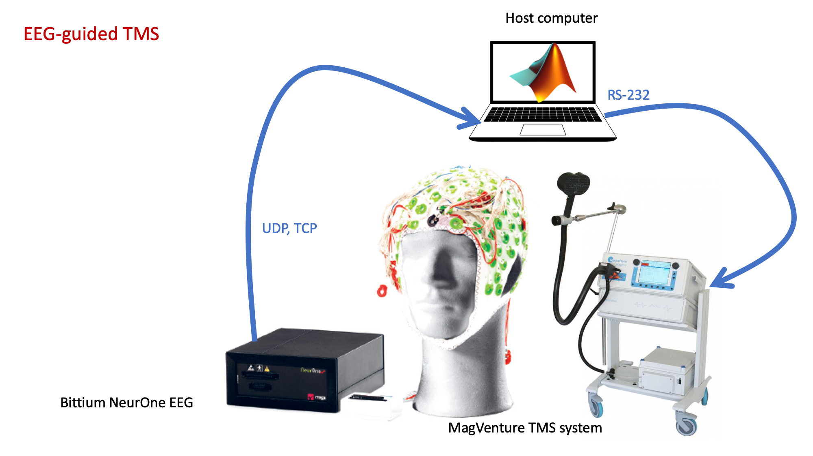

# Navigating neuromodulation devices via real-time spatiotemporal guidance

Imaging-guided neuromodulation: track the head and a TMS coil in real time with a camera, register them to the
subject's MRI, guide or move the coil to a target, and time the stimulation to the brain's ongoing EEG activity.

## Repository map

| Path | What |
|---|---|
| [`codes/`](codes/) | MATLAB navigation app (`nav_camera_terminal.mlapp`) and its functions: camera link, landmark registration, graphics, and the Robot tab |
| [`TMS_Robot/`](TMS_Robot/) | **Sub-project: the TMS coil robot.** LabVIEW robot program, Windows bridge, simulators and docs. Start at [`TMS_Robot/README.md`](TMS_Robot/README.md) |
| [`doc/polaris/`](doc/polaris/) | NDI Polaris Vega manuals (user guide, API guide, tool design, accuracy kit) and tool `.rom` files |
| [`images/`](images/) | Figures and screenshots used by the docs |

## 1. Navigation by camera

An NDI Polaris Vega ST camera tracks the subject's head marker, a pointer and the coil marker in real time. The MATLAB
app talks to the camera directly from a Mac over Ethernet (no PlusServer or Windows needed), registers the head to the
MRI with pointer landmarks, and follows the brain as the head moves.

- Setup and use: [`codes/README_navigation.md`](codes/README_navigation.md)
- The math of landmark sampling and registration: [`codes/README_nav_brain_landmark.md`](codes/README_nav_brain_landmark.md)
- Lab wiki notes on the earlier setup: [Connect to Polaris Vega camera](https://github.com/fahsuanlin/labmanual/wiki/27.-Connec-to-Polaris-Vega-camera)

## 2. Robotic coil positioning

The app's **Robot** tab shows the coil marker relative to a target. It sends the offset, and optionally move
commands, to the TMS robot through a bridge program on the robot's Windows PC. See [`TMS_Robot/README.md`](TMS_Robot/README.md).

## 3. Real-time communication with the EEG system (planned)

The NeurOne Tesla EEG system (Bittium, Oulu, Finland) streams data in real time over UDP (NeurOne user manual,
Appendix 11; the manual is not in this repository).

- Task 1: receive the NeurOne UDP stream in MATLAB.
- Task 2: estimate the oscillatory phase in real time to time the stimulation.

Related resources:
- [phastimate](https://github.com/bnplab/phastimate): oscillatory phase estimation toolbox (Tübingen / CAMH)
- [A state-space model for phase estimation](https://elifesciences.org/articles/68803), code [here](https://github.com/tne-lab/phase-calculator)
