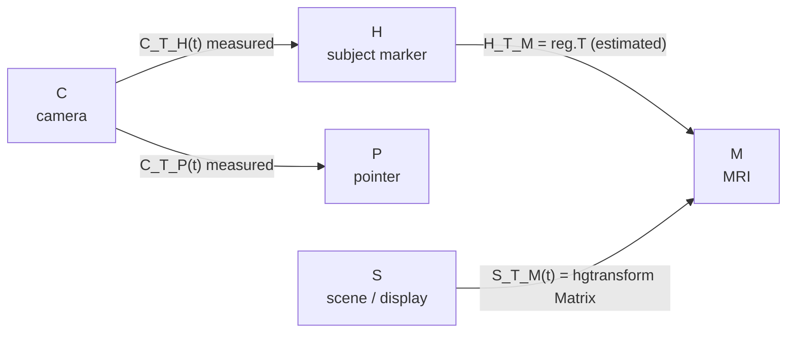
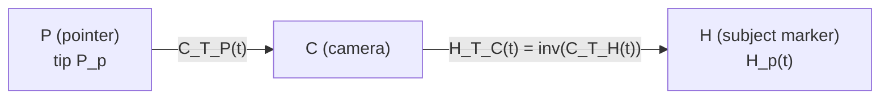
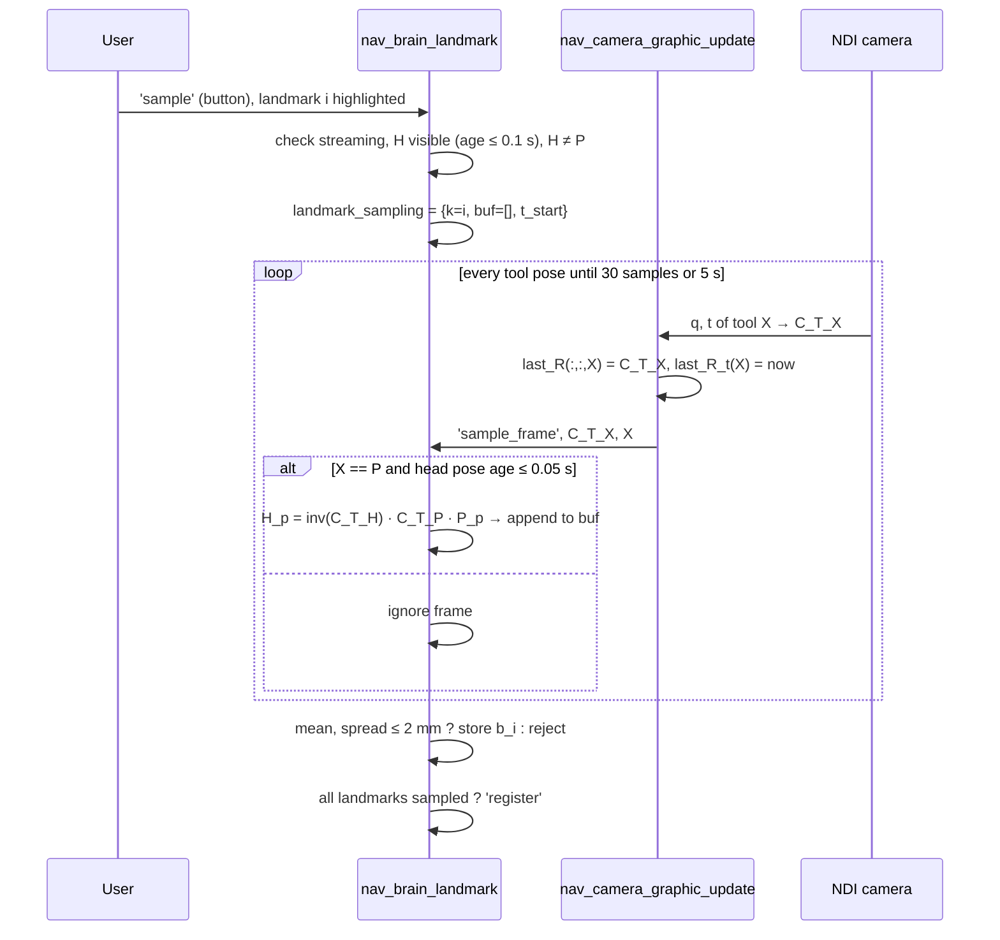
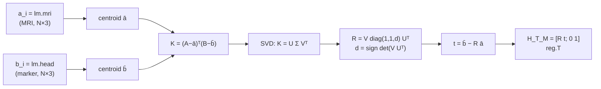
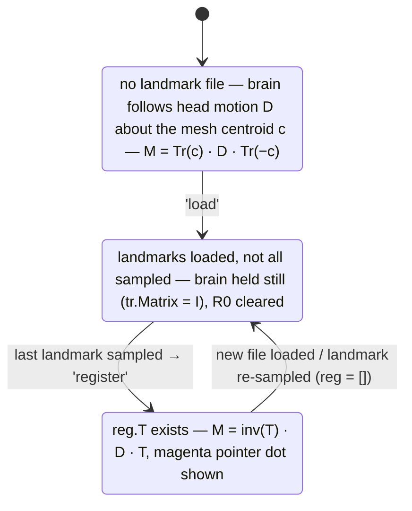
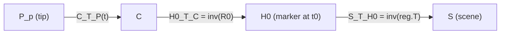
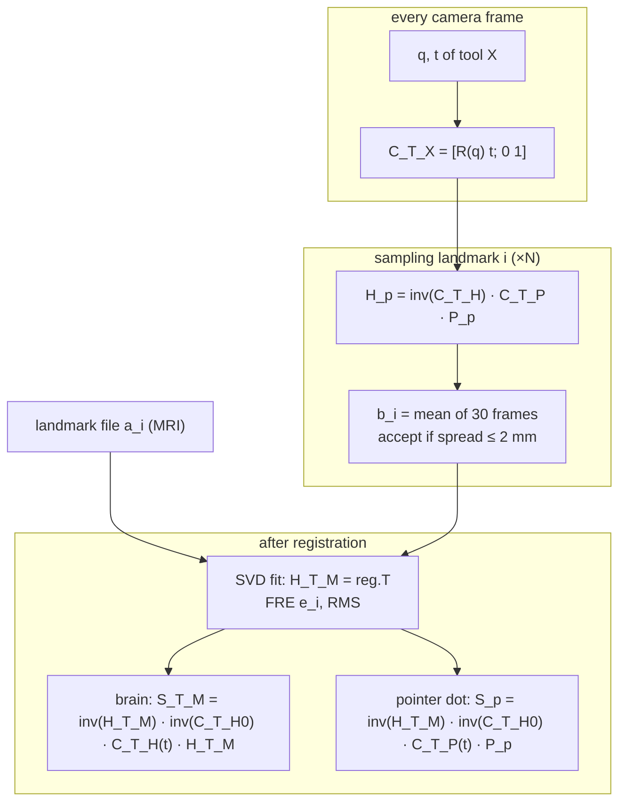

# `nav_brain_landmark.m` — the math of landmark sampling and registration

This document explains, step by step, how `nav_brain_landmark.m` (with the per-frame code in
`nav_camera_graphic_update.m`) turns

* poses of a **pointer tool** and a **subject (head) marker tool** reported by the NDI camera, and
* anatomical **landmark coordinates** picked on the subject's MRI head surface (`prep_landmark.m`)

into one rigid transform between the MRI and the subject marker, and how that transform is then
used to move the brain on screen and to show the pointer tip on the MRI.

---

## 0. Contents

1. [Coordinate frames](#1-coordinate-frames)
2. [Notation for transformation matrices](#2-notation-for-transformation-matrices)
3. [From camera data to a pose matrix](#3-from-camera-data-to-a-pose-matrix)
4. [Sampling one landmark: pointer tip in the subject-marker frame](#4-sampling-one-landmark-pointer-tip-in-the-subject-marker-frame)
5. [Averaging and the stillness test](#5-averaging-and-the-stillness-test)
6. [Registration: MRI → subject marker (SVD / Kabsch)](#6-registration-mri--subject-marker-svd--kabsch)
7. [Registration error](#7-registration-error)
8. [Using the registration: moving the brain](#8-using-the-registration-moving-the-brain)
9. [Using the registration: showing the pointer tip on the MRI](#9-using-the-registration-showing-the-pointer-tip-on-the-mri)
10. [Consistency check: why the dot lands on the landmark](#10-consistency-check-why-the-dot-lands-on-the-landmark)
11. [Symbol ↔ code cheat sheet](#11-symbol--code-cheat-sheet)
12. [Assumptions and limitations](#12-assumptions-and-limitations)

---

## 1. Coordinate frames

Five frames appear. Every one is a right-handed Cartesian frame in **millimetres**.

| Frame | Symbol | Origin / axes | Attached to | Moves? |
|---|---|---|---|---|
| Camera | $C$ | NDI Polaris measurement frame | camera body | fixed (assumed) |
| Subject marker (head tracker) | $H$ | defined by the tool's `.rom` file | marker rigidly fixed to the subject's head | yes, with the head |
| Pointer tool | $P$ | defined by the pointer's `.rom` file; for NDI probes the origin is the tip | pointer | yes, with the hand |
| MRI | $M$ | FreeSurfer surface (tkr-RAS) coordinates of `lh.seghead.tri` | the subject's anatomy | rigid with the head, so rigid with $H$ |
| Scene (display) | $S$ | coordinates of `app.UIAxes2` (the Brain tab) | screen | fixed |

The key physical fact used by the whole method:

> The subject marker $H$ is screwed/strapped to the head, so the head anatomy (and therefore the
> MRI frame $M$) does **not** move relative to $H$. The transform between $M$ and $H$ is a constant
> to be estimated — that is the registration.

```
                         NDI camera   (frame C, fixed)
                        ┌──────────┐
                        │  ◉    ◉  │
                        └────┬─────┘
                 C_T_H(t)  ╱   ╲  C_T_P(t)       measured every frame
                         ╱       ╲
                       ╱           ╲
            ┌─────────▼──┐        ┌─▼──────────────┐
            │ subject    │        │ pointer tool P │
            │ marker H   │        │   ●●●          │
            │  ●●●       │        │    ╲           │
            └─────┬──────┘        │     ╲  tip     │
     H_T_M        │ (rigid,       └──────●─────────┘
   (unknown,      │  constant)           │ P_p = tip in P (landmark_tip)
    estimated)    ▼                      ▼ touches landmark i
            ┌──────────────────────────────────┐
            │  head / MRI anatomy (frame M)     │
            │   Nasion ●   LPA ●   RPA ●  ...    │
            └──────────────────────────────────┘
```

Frame graph (an arrow `A → B` labelled `A_T_B` means "the matrix that converts coordinates
expressed in $B$ into coordinates expressed in $A$"):



---

## 2. Notation for transformation matrices

### 2.1 Homogeneous rigid transforms

A rigid transform is a $4\times4$ matrix

$$
{}^{A}T_{B} \;=\;
\begin{bmatrix}
{}^{A}\mathbf{R}_{B} & {}^{A}\mathbf{t}_{B} \\
\mathbf{0}^{\top} & 1
\end{bmatrix},
\qquad
{}^{A}\mathbf{R}_{B}\in SO(3),\;\;
{}^{A}\mathbf{t}_{B}\in\mathbb{R}^{3}\ (\text{mm}).
$$

**Convention used everywhere in this document:**

$$
\boxed{\;{}^{A}\tilde{\mathbf{x}} \;=\; {}^{A}T_{B}\;{}^{B}\tilde{\mathbf{x}}\;}
$$

where ${}^{B}\tilde{\mathbf{x}} = [x\;y\;z\;1]^\top$ is a point written in frame $B$ (homogeneous
coordinates), and ${}^{A}\tilde{\mathbf{x}}$ is the *same physical point* written in frame $A$.
Read ${}^{A}T_{B}$ as "*$B$ expressed in $A$*", or equivalently "*the pose of $B$ in $A$*":

* ${}^{A}\mathbf{t}_{B}$ is the origin of $B$, written in $A$;
* the columns of ${}^{A}\mathbf{R}_{B}$ are the $x,y,z$ axes of $B$, written in $A$.

### 2.2 Rules

Chaining (the inner frame names must match and "cancel"):

$$
{}^{A}T_{B}\;{}^{B}T_{C} = {}^{A}T_{C}
$$

Inverse (swap the frame names):

$$
\left({}^{A}T_{B}\right)^{-1} = {}^{B}T_{A}
=
\begin{bmatrix}
{}^{A}\mathbf{R}_{B}^{\top} & -\,{}^{A}\mathbf{R}_{B}^{\top}\,{}^{A}\mathbf{t}_{B} \\
\mathbf{0}^{\top} & 1
\end{bmatrix}
$$

The right-hand side is exactly the helper `rigid_inv` in both `.m` files:

```matlab
function Ri=rigid_inv(R)
Ri=[R(1:3,1:3).', -R(1:3,1:3).'*R(1:3,4); 0 0 0 1];
```

(using the transpose instead of `inv()` is exact and numerically stable for a rotation.)

### 2.3 Time

Tracked poses change with time; a time argument is written explicitly: ${}^{C}T_{H}(t)$.
The subscript $0$ denotes the reference time $t_0$ at which the brain display starts following
the head (Section 8). Constant transforms carry no time argument: ${}^{H}T_{M}$, ${}^{P}\mathbf{p}$.

---

## 3. From camera data to a pose matrix

For each tracked tool $X\in\{H,P\}$ and each frame, the camera (BX or BX2 reply, decoded in
`nav_camera_terminal.mlapp`) reports a unit quaternion and a translation:

$$
\mathbf{q} = [q_0,\,q_x,\,q_y,\,q_z]^\top,\qquad
\mathbf{t} = [t_x,\,t_y,\,t_z]^\top\ \text{(mm)} .
$$

`nav_quat_rot.m` normalises $\mathbf{q}$ (the camera sends single precision) and converts it to a
rotation matrix:

$$
\mathbf{R}(\mathbf{q}) =
\begin{bmatrix}
q_0^2+q_x^2-q_y^2-q_z^2 & 2(q_xq_y-q_0q_z) & 2(q_xq_z+q_0q_y)\\
2(q_xq_y+q_0q_z) & q_0^2-q_x^2+q_y^2-q_z^2 & 2(q_yq_z-q_0q_x)\\
2(q_xq_z-q_0q_y) & 2(q_yq_z+q_0q_x) & q_0^2-q_x^2-q_y^2+q_z^2
\end{bmatrix}.
$$

The app then builds the $4\times4$ pose and passes it as `R` to `nav_camera_graphic_update`:

$$
{}^{C}T_{X}(t) =
\begin{bmatrix}\mathbf{R}(\mathbf{q}) & \mathbf{t}\\ \mathbf{0}^\top & 1\end{bmatrix}
\qquad\longleftrightarrow\qquad
\texttt{R=[M t; 0 0 0 1]}
$$

i.e. the camera reports the pose **of the tool in the camera frame**: it maps tool coordinates to
camera coordinates. `nav_camera_graphic_update` stores the latest one for each tool:

| Stored | Meaning |
|---|---|
| `app.nav_camera.last_R(:,:,k)` | ${}^{C}T_{X_k}$, latest pose of tool $k$ (NaN if missing) |
| `app.nav_camera.last_R_t(k)` | arrival time of that pose (s since `clock0`) |

Tool indices: $H$ = `app.BrainToolDropDown.Value` (`head_idx`), $P$ =
`app.LandmarkToolDropDown.Value` (`ptr_idx`). They must differ.

> Side note: the matrix `C=[0 -1 0; -1 0 0; 0 0 -1]` in `nav_camera_graphic_update.m` only
> re-orients positions for the *camera* tab plot. It plays no role in landmark sampling or
> registration.

---

## 4. Sampling one landmark: pointer tip in the subject-marker frame

### 4.1 The landmark list

`prep_landmark.m` lets you click landmarks on the scalp surface (default `LPA`, `RPA`, `Nasion`,
`Nose tip`). The file loaded by `nav_brain_landmark(app,'load')` contains `sensor.name` and
`sensor.coords`; the latter becomes

$$
\mathbf{a}_i = {}^{M}\mathbf{x}_i \in\mathbb{R}^3,\qquad i=1,\dots,N
\qquad(\texttt{lm.mri(i,:)})
$$

the position of landmark $i$ in **MRI** coordinates. The matching positions in the **subject
marker** frame are unknown at load time:

$$
\mathbf{b}_i = {}^{H}\mathbf{x}_i \qquad(\texttt{lm.head(i,:)} = \text{NaN initially})
$$

### 4.2 The pointer tip

The "hot spot" of the pointer is a fixed point in the pointer's own frame:

$$
{}^{P}\mathbf{p} \qquad(\texttt{app.nav\_camera.landmark\_tip},\ \text{default } [0,0,0]^\top)
$$

For NDI probes the `.rom` file puts the tool origin at the tip, so ${}^{P}\mathbf{p}=\mathbf{0}$
and the tip is simply ${}^{C}\mathbf{t}_{P}$.

### 4.3 The core equation

At a frame time $t$, with the tip held on landmark $i$, the tip in camera coordinates is

$$
{}^{C}\tilde{\mathbf{p}}(t) = {}^{C}T_{P}(t)\;{}^{P}\tilde{\mathbf{p}} .
$$

We do **not** want camera coordinates: the head may move, and the camera could be bumped. We
re-express the tip in the subject-marker frame by going *backwards* along ${}^{C}T_{H}$:

$$
\boxed{\;
{}^{H}\tilde{\mathbf{p}}(t)
= {}^{H}T_{C}(t)\;{}^{C}T_{P}(t)\;{}^{P}\tilde{\mathbf{p}}
= \left({}^{C}T_{H}(t)\right)^{-1}{}^{C}T_{P}(t)\;{}^{P}\tilde{\mathbf{p}}
= {}^{H}T_{P}(t)\;{}^{P}\tilde{\mathbf{p}}
\;}
$$

Code (`'sample_frame'` action, line 136):

```matlab
x = rigid_inv(R_head) * R * [tip;1];     % R_head = C_T_H,  R = C_T_P
```



Geometrically:

```
     camera C ─────────────────────────────────────────────┐
        │  C_T_H(t)                              C_T_P(t)   │
        ▼                                                   ▼
   ┌─────────┐   H_T_P(t) = inv(C_T_H) · C_T_P   ┌──────────────┐
   │ marker H│ ◄───────────────────────────────── │  pointer P   │
   └─────────┘                                    └──────●───────┘
                                                         tip P_p
   H_p(t) = H_T_P(t) · P_p     ← tip position relative to the head
```

Why this is the right quantity: because $H$ is rigid with the head, the landmark has a **fixed**
position $\mathbf{b}_i={}^{H}\mathbf{x}_i$ in $H$, regardless of where the head or camera is. So
${}^{H}\mathbf{p}(t)\approx\mathbf{b}_i$ for every frame while the tip touches landmark $i$ — the
subject may even move slightly during sampling.

### 4.4 Pairing the two poses in time

The camera reports $H$ and $P$ as separate items, so `sample_frame` is called for each pointer
pose and pairs it with the **most recent** head pose, accepted only if that head pose is fresh:

$$
t_{\text{now}} - t_{H} \le 0.05\ \text{s}\qquad(\texttt{max\_head\_age})
$$

At 60 Hz both poses usually come from the same camera frame. Frames with a missing pointer
(NaN pose) or a stale/missing head pose are skipped, not counted.

### 4.5 Sequence of one sample



---

## 5. Averaging and the stillness test

After $K=30$ accepted frames (`n_sample`, ≈ 0.5 s at 60 Hz) with samples
${}^{H}\mathbf{p}^{(1)},\dots,{}^{H}\mathbf{p}^{(K)}$:

**Mean (the landmark estimate in $H$):**

$$
\mathbf{b}_i = \frac{1}{K}\sum_{k=1}^{K}{}^{H}\mathbf{p}^{(k)}
\qquad(\texttt{m=mean(s.buf,2)})
$$

**Spread (worst deviation from the mean):**

$$
s_i = \max_{k}\;\bigl\|{}^{H}\mathbf{p}^{(k)}-\mathbf{b}_i\bigr\|_2
\qquad(\texttt{spread})
$$

Accept if $s_i\le 2$ mm (`max_spread`), else reject and ask to sample again. Timeout: if 30
good frames are not collected within 5 s (`sample_timeout`), the sample is abandoned.

```
     samples of H_p around landmark i (top view)

               ·  ·
            ·   ✚ ·  ·          ✚ = mean b_i
              ·  ·  ·
          ◄─── s_i ───►         accept if the farthest sample is within 2 mm of the mean
```

Averaging reduces the random tracking noise of each frame by about $1/\sqrt{K}$; the spread
test rejects samples taken while the pointer was sliding.

When accepted: `lm.head(i,:) = b_i'`, any old registration is cleared (`reg=[]`), the next
unsampled landmark is highlighted, and when **every** landmark has a $\mathbf{b}_i$ the
registration runs automatically.

---

## 6. Registration: MRI → subject marker (SVD / Kabsch)

### 6.1 The problem

We now have $N$ corresponding point pairs

$$
\mathbf{a}_i = {}^{M}\mathbf{x}_i\ \ (\text{MRI, from the file}),\qquad
\mathbf{b}_i = {}^{H}\mathbf{x}_i\ \ (\text{subject marker, sampled}),
$$

and want the constant rigid transform ${}^{H}T_{M}$ with

$$
{}^{H}\tilde{\mathbf{x}} = {}^{H}T_{M}\;{}^{M}\tilde{\mathbf{x}},
\qquad
{}^{H}T_{M}=\begin{bmatrix}\mathbf{R}&\mathbf{t}\\ \mathbf{0}^\top&1\end{bmatrix}
$$

(in code `T = [Rr t; 0 0 0 1]`, stored as `app.nav_camera.reg.T`, comment "MRI → head-tracker
frame"). With noisy samples it is chosen in the least-squares sense:

$$
(\mathbf{R}^\star,\mathbf{t}^\star) = \arg\min_{\mathbf{R}\in SO(3),\ \mathbf{t}\in\mathbb{R}^3}
\;\sum_{i=1}^{N}\bigl\|\mathbf{R}\,\mathbf{a}_i+\mathbf{t}-\mathbf{b}_i\bigr\|^2 .
$$

```
     MRI frame M                                  subject-marker frame H
                                    R, t
      LPA ●        ● RPA        ───────────►        ●LPA'        ●RPA'
            ● Nasion                                      ●Nasion'
              ● Nose tip                                    ●Nose tip'
      (a_i : lm.mri)                                (b_i : lm.head)
```

At least $N=3$ non-collinear landmarks are required (the code checks $N\ge3$; collinear points
leave a rotation about their line undetermined).

### 6.2 Step 1 — remove translation with centroids

$$
\bar{\mathbf{a}}=\frac1N\sum_i\mathbf{a}_i,\qquad
\bar{\mathbf{b}}=\frac1N\sum_i\mathbf{b}_i,\qquad
\mathbf{a}_i'=\mathbf{a}_i-\bar{\mathbf{a}},\qquad
\mathbf{b}_i'=\mathbf{b}_i-\bar{\mathbf{b}} .
$$

Setting $\partial/\partial\mathbf{t}=0$ gives

$$
\mathbf{t}^\star = \bar{\mathbf{b}}-\mathbf{R}^\star\bar{\mathbf{a}}
\qquad(\texttt{t=cb.'-Rr*ca.'})
$$

and the problem becomes a pure rotation fit $\min_{\mathbf{R}}\sum_i\|\mathbf{R}\mathbf{a}_i'-\mathbf{b}_i'\|^2$.

### 6.3 Step 2 — cross-covariance and SVD

Expanding, $\|\mathbf{R}\mathbf{a}'\|=\|\mathbf{a}'\|$, so minimising the error is the same as
maximising

$$
\sum_i \mathbf{b}_i'^{\top}\mathbf{R}\,\mathbf{a}_i'
= \operatorname{tr}\!\Bigl(\mathbf{R}\sum_i\mathbf{a}_i'\mathbf{b}_i'^{\top}\Bigr)
= \operatorname{tr}(\mathbf{R}\,\mathbf{K}),
\qquad
\mathbf{K}=\sum_i\mathbf{a}_i'\mathbf{b}_i'^{\top}=\mathbf{A}_c^{\top}\mathbf{B}_c\ (3\times3)
$$

where $\mathbf{A}_c,\mathbf{B}_c$ are the $N\times3$ centred point matrices (`A-ca`, `B-cb`).
Take the SVD

$$
\mathbf{K}=\mathbf{U}\,\boldsymbol{\Sigma}\,\mathbf{V}^{\top}
\qquad(\texttt{[U,~,V]=svd((A-ca).'*(B-cb))})
$$

Then $\operatorname{tr}(\mathbf{R}\mathbf{U}\boldsymbol{\Sigma}\mathbf{V}^\top)
=\operatorname{tr}(\mathbf{V}^\top\mathbf{R}\mathbf{U}\,\boldsymbol{\Sigma})$, which (since
$\mathbf{V}^\top\mathbf{R}\mathbf{U}$ is orthogonal and $\boldsymbol{\Sigma}\ge0$ is diagonal) is
largest when $\mathbf{V}^\top\mathbf{R}\mathbf{U}=\mathbf{I}$, i.e. $\mathbf{R}=\mathbf{V}\mathbf{U}^\top$.

### 6.4 Step 3 — forbid reflections

$\mathbf{V}\mathbf{U}^\top$ may have determinant $-1$ (a mirror image), e.g. with noisy or nearly
planar points. The proper rotation closest to optimal is

$$
\boxed{\;
\mathbf{R}^\star=\mathbf{V}\,
\begin{bmatrix}1&0&0\\0&1&0\\0&0&d\end{bmatrix}
\mathbf{U}^{\top},
\qquad d=\operatorname{sign}\det(\mathbf{V}\mathbf{U}^{\top})
\;}
\qquad(\texttt{Rr=V*diag([1 1 sign(det(V*U.'))])*U.'})
$$

so $\det\mathbf{R}^\star=+1$ always.

### 6.5 Result

$$
\boxed{\;
{}^{H}T_{M}=
\begin{bmatrix}\mathbf{R}^\star & \bar{\mathbf{b}}-\mathbf{R}^\star\bar{\mathbf{a}}\\ \mathbf{0}^\top & 1\end{bmatrix}
= \texttt{app.nav\_camera.reg.T}
\;}
$$

This matrix is the "final registration between the subject's marker and the anatomy": any MRI
point can now be located relative to the subject marker, and — through the live camera pose
${}^{C}T_{H}(t)$ — in the camera at any time:

$$
{}^{C}\tilde{\mathbf{x}}(t) = {}^{C}T_{H}(t)\;{}^{H}T_{M}\;{}^{M}\tilde{\mathbf{x}} .
$$



---

## 7. Registration error

For each landmark used:

$$
e_i = \bigl\|\mathbf{R}^\star\mathbf{a}_i+\mathbf{t}^\star-\mathbf{b}_i\bigr\|_2
\qquad(\texttt{reg.err})
$$

$$
\text{RMS} = \sqrt{\frac1N\sum_i e_i^2}\qquad(\texttt{reg.rms})
$$

These are **fiducial registration errors (FRE)** — residuals at the landmarks themselves — and
are shown in the Brain-tab title, e.g. `Registered with 4 landmarks, RMS 2.3 mm (LPA 1.9, ...)`.
A single large $e_i$ usually means that landmark was touched at a different spot than the one
clicked on the MRI. Note that a small FRE does not guarantee a small error at a *target* deep in
the brain (TRE); spreading landmarks widely around the head helps TRE.

---

## 8. Using the registration: moving the brain

Registration also resets `app.nav_camera.R0=[]`. On the next head-marker frame,
`nav_camera_graphic_update` stores the reference pose

$$
{}^{C}T_{H_0} = {}^{C}T_{H}(t_0)\qquad(\texttt{app.nav\_camera.R0})
$$

and defines the **scene frame** $S$ (the Brain tab axes) to coincide with the MRI frame **as the
head was at $t_0$**:

$$
{}^{S}T_{H_0} \equiv \left({}^{H}T_{M}\right)^{-1} = {}^{M}T_{H}
\qquad\Longleftrightarrow\qquad
{}^{S}T_{M}(t_0)=\mathbf{I}
$$

So at $t_0$ the mesh is drawn untransformed (`tr.Matrix = eye(4)`), in its own MRI coordinates,
and the landmark dots (children of the same `hgtransform`) sit on it.

At a later time $t$ the head (and $M$, $H$ with it) has moved. Where is the MRI now, in the
scene? Chain from $M$ to $S$ through the camera:

$$
{}^{S}T_{M}(t)
= \underbrace{{}^{S}T_{H_0}}_{(\,{}^{H}T_{M})^{-1}}\;
\underbrace{{}^{H_0}T_{C}}_{(\,{}^{C}T_{H_0})^{-1}}\;
\underbrace{{}^{C}T_{H}(t)}_{\text{live}}\;
\underbrace{{}^{H}T_{M}}_{\text{reg.T}}
$$

Grouping the middle two factors as the head motion

$$
\mathbf{D}(t) = {}^{H_0}T_{H}(t) = \left({}^{C}T_{H_0}\right)^{-1}{}^{C}T_{H}(t)
\qquad(\texttt{D = rigid\_inv(R0)*R})
$$

gives the **similarity transform**

$$
\boxed{\;
{}^{S}T_{M}(t) = \left({}^{H}T_{M}\right)^{-1}\,\mathbf{D}(t)\,{}^{H}T_{M}
\;}
\qquad(\texttt{M = rigid\_inv(T)*D*T})
$$

i.e. *"the head motion measured in marker coordinates, re-expressed in MRI coordinates"*.
`M` is written to the brain's `hgtransform` (`etc_render_fsbrain.tr.Matrix`), so every vertex
${}^{M}\mathbf{v}$ of the mesh is displayed at ${}^{S}T_{M}(t)\,{}^{M}\tilde{\mathbf{v}}$.
Rotations thus happen about MRI axes and the true anatomical pivot rather than about the marker.

(The code then re-orthonormalises the $3\times3$ block with an SVD,
$\mathbf{M}_{1:3,1:3}\leftarrow\mathbf{U}\mathbf{V}^\top$, only to remove floating-point drift that
`hgtransform` would warn about.)

```
       t0                                 t
  ┌────────────┐   head turns     ┌────────────┐
  │   brain    │  ─────────────►  │   brain ↻  │     D(t) = H0_T_H(t)       (in marker axes)
  │  S ≡ M(t0) │                  │            │     S_T_M = inv(T)·D·T     (in MRI axes)
  └────────────┘                  └────────────┘
   tr.Matrix = I                   tr.Matrix = S_T_M(t)
```

### Display modes (from `nav_camera_graphic_update.m`)



---

## 9. Using the registration: showing the pointer tip on the MRI

Once registered, every pointer frame computes the tip in scene coordinates (magenta dot,
`app.nav_camera.lm_ptr_h`, parented to the axes, **not** to the brain `hgtransform`):

$$
\boxed{\;
{}^{S}\tilde{\mathbf{p}}(t)
= {}^{S}T_{H_0}\;{}^{H_0}T_{C}\;{}^{C}T_{P}(t)\;{}^{P}\tilde{\mathbf{p}}
= \left({}^{H}T_{M}\right)^{-1}\left({}^{C}T_{H_0}\right)^{-1}{}^{C}T_{P}(t)\;{}^{P}\tilde{\mathbf{p}}
\;}
$$

```matlab
x = rigid_inv(app.nav_camera.reg.T) * rigid_inv(app.nav_camera.R0) * R * [tip;1];   % R = C_T_P
```



The dot is hidden whenever the pointer pose is missing or older than 0.1 s.

---

## 10. Consistency check: why the dot lands on the landmark

Suppose at time $t$ the tip touches anatomical point ${}^{M}\mathbf{x}$ (e.g. the nasion).
Physically the tip and that point coincide, so in camera coordinates

$$
{}^{C}T_{P}(t)\,{}^{P}\tilde{\mathbf{p}} = {}^{C}T_{H}(t)\,{}^{H}T_{M}\,{}^{M}\tilde{\mathbf{x}} .
$$

Substitute into the dot formula of Section 9:

$$
{}^{S}\tilde{\mathbf{p}}(t)
= \left({}^{H}T_{M}\right)^{-1}\left({}^{C}T_{H_0}\right)^{-1}{}^{C}T_{H}(t)\,{}^{H}T_{M}\,{}^{M}\tilde{\mathbf{x}}
= \left({}^{H}T_{M}\right)^{-1}\mathbf{D}(t)\,{}^{H}T_{M}\,{}^{M}\tilde{\mathbf{x}}
= {}^{S}T_{M}(t)\,{}^{M}\tilde{\mathbf{x}} ,
$$

which is exactly where the mesh vertex ${}^{M}\mathbf{x}$ is drawn (Section 8). So with a perfect
registration the magenta dot sits on the touched point of the moving mesh, whatever the head and
camera did — the residual offset you see is the registration + tracking error at that point.
Touching each landmark after registration is the quickest validation.

Also at sampling time (Section 4), by the same reasoning,

$$
\mathbf{b}_i = {}^{H}\mathbf{p} = \left({}^{C}T_{H}\right)^{-1}{}^{C}T_{P}\,{}^{P}\mathbf{p}
= {}^{H}T_{M}\,\mathbf{a}_i ,
$$

which is precisely the model $\mathbf{b}_i=\mathbf{R}\mathbf{a}_i+\mathbf{t}$ fitted in Section 6.

### Full picture



---

## 11. Symbol ↔ code cheat sheet

| Symbol | Meaning | Code |
|---|---|---|
| ${}^{C}T_{X}(t)$ | pose of tool $X$ in camera, from $\mathbf{q},\mathbf{t}$ | `R` (arg of `graphic_update` / `sample_frame`), `last_R(:,:,k)` |
| ${}^{C}T_{H}(t)$ | subject-marker pose | `R_head` (`last_pose(app,head_idx)`) |
| ${}^{C}T_{P}(t)$ | pointer pose | `R` when `component_idx==ptr_idx` |
| ${}^{H}T_{C}(t)$ | inverse of marker pose | `rigid_inv(R_head)` |
| ${}^{P}\mathbf{p}$ | tip in pointer frame | `landmark_tip` (default `[0;0;0]`) |
| ${}^{H}\mathbf{p}(t)$ | tip in marker frame, one frame | `x(1:3)` → `s.buf(:,end+1)` |
| $\mathbf{a}_i={}^{M}\mathbf{x}_i$ | landmark in MRI | `lm.mri(i,:)`, `A` |
| $\mathbf{b}_i={}^{H}\mathbf{x}_i$ | landmark in marker (averaged) | `lm.head(i,:)`, `B` |
| $s_i$ | sampling spread | `lm.spread(i)` |
| $\bar{\mathbf{a}},\bar{\mathbf{b}}$ | centroids | `ca`, `cb` |
| $\mathbf{K}$ | cross-covariance | `(A-ca).'*(B-cb)` |
| $\mathbf{R}^\star,\mathbf{t}^\star$ | fitted rotation / translation | `Rr`, `t` |
| ${}^{H}T_{M}$ | **registration**, MRI → marker | `T`, `app.nav_camera.reg.T` |
| $e_i$, RMS | fiducial registration errors | `reg.err`, `reg.rms` |
| ${}^{C}T_{H_0}$ | marker pose when following starts | `app.nav_camera.R0` |
| $\mathbf{D}(t)={}^{H_0}T_{H}(t)$ | head motion since $t_0$ | `D` |
| ${}^{S}T_{M}(t)$ | MRI → scene (brain display) | `M` → `etc_render_fsbrain.tr.Matrix` |
| ${}^{S}\mathbf{p}(t)$ | pointer tip in scene | `x` → `app.nav_camera.lm_ptr_h` |

Parameters: `n_sample=30`, `max_spread=2` mm, `max_head_age=0.05` s, `sample_timeout=5` s,
head visibility at click ≤ 0.1 s, pointer validity for the button ≤ 0.1 s.

---

## 12. Assumptions and limitations

* **Rigid head–marker attachment.** Any slip of the subject marker after registration shifts
  everything by the slip; re-register (re-load or re-sample) if it is bumped.
* **Fixed camera between $t_0$ and $t$.** The display uses ${}^{C}T_{H_0}$ as an anchor, so the
  brain motion shown is head motion *relative to the camera*. Sampling and registration
  themselves are camera-independent (everything is in $H$).
* **Correspondence.** Each $\mathbf{a}_i$ must be the same anatomical spot touched for
  $\mathbf{b}_i$; soft-tissue landmarks (nose tip) can deform under pointer pressure.
* **Point-based registration only.** No surface refinement (ICP) is done; with 4 landmarks the
  accuracy away from them depends on how well they surround the region of interest.
* **Tip calibration.** ${}^{P}\mathbf{p}$ must be correct; a wrong tip offset adds a
  pose-dependent error to every $\mathbf{b}_i$.
